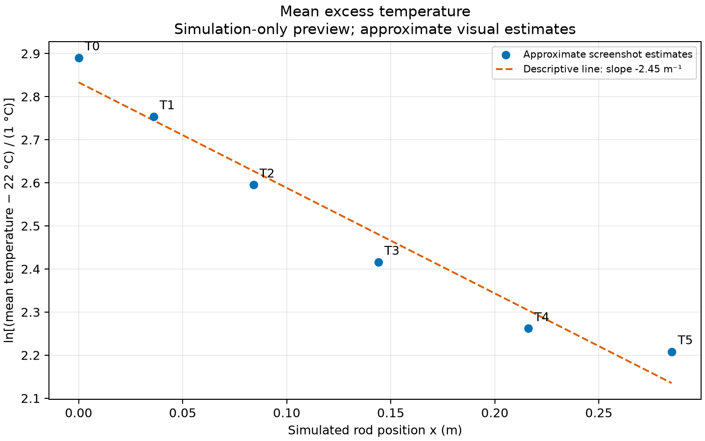
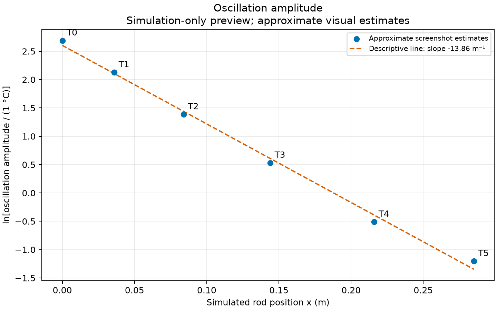

# Six-sensor Angstrom simulation preview

Source: https://sethfraden.github.io/Phys39F26-course/simulators/angstrom-six-sensor/

Settings shown: aluminum 6061, diameter 12.7 mm, length 300 mm; sinusoidal mean 40 °C, amplitude 16 °C, period 200 s; P enabled at 8 %/°C, I enabled at 0.15 %/(°C·s), D off. Simulator ambient: **22 °C**.

The following are rough visual estimates from the user's paused screenshot, not exported samples or fitted results. No precision beyond the displayed estimates is implied; the farthest traces are particularly difficult to read.

| Simulated sensor | Position (m) | Estimated mean (°C) | Estimated amplitude (°C) |
|---|---:|---:|---:|
| T0 | 0 | 40.0 | 14.7 |
| T1 | 0.036 | 37.7 | 8.4 |
| T2 | 0.084 | 35.4 | 4.0 |
| T3 | 0.144 | 33.2 | 1.7 |
| T4 | 0.216 | 31.6 | 0.6 |
| T5 | 0.285 | 31.1 | 0.3 |

Observed cycles appear repeatable. Oscillation amplitudes decrease downstream and peaks occur progressively later. PWM peaks before the nearby thermal response in this displayed run. Quantitative phase lags have not been extracted. Simulator T0 is the modeled rod boundary; it must not be confused with the separate TEC/A0 channel in the physical apparatus, whose rod boundary is T1.

## Ambient temperature distinction

The user reports current **physical room temperature approximately 26 °C** (November 4, 2026; uncertainty and exact observation time not supplied). This is physical-run metadata, not a change to the simulator's displayed 22 °C ambient. Use **22 °C** for excess temperatures from these simulator observations. Enter the actual measured physical ambient in the acquisition GUI before the physical trial; no control setting was changed automatically by this note.

## Remaining preview work

Use these approximate means and amplitudes to plot ln[(mean − 22 °C)/(1 °C)] and ln[amplitude/(1 °C)] against simulated position. Compare slopes and possible tip departures without claiming a precise model test from screenshot estimates. Obtain phase estimates or exported samples if available, then vary the simulated period to inspect attenuation and phase lag. This is a simulation-only record, not physical acquisition data or a numerical settling test.

## Simulation log plots

Simulator ambient is 22 °C. The separately reported physical ambient of approximately 26 °C is not used here. Both logarithms are dimensionless, with temperatures normalized by 1 °C.

All-point descriptive slopes are **-2.45 m⁻¹** for mean excess and **-13.86 m⁻¹** for amplitude. Thus the oscillation amplitude falls more steeply than the mean excess temperature. These are descriptive lines through rough visual estimates, not precise fitted transport parameters; no statistical confidence interval is justified by these inputs.

The mean-excess points flatten toward the tip relative to the all-point line, consistent qualitatively with a finite-end effect. The amplitude points are roughly linear on the log plot, but the tiny T4/T5 amplitudes are particularly uncertain. Neither observation validates a boundary condition or semi-infinite approximation quantitatively. Phase delays still require separate estimates or exported data.

[Calculated log values and descriptive residuals](log_values.csv). Regenerate with `python3 python/analysis/plot_simulation_preview.py`.

## 100 s period comparison

The final paused screenshot shows visually repeatable cycles after the earlier startup drift. Settings remain Ta = 40 °C, Tb = 16 °C, ambient 22 °C, and the same simulator geometry and PI settings; period is now 100 s. Visual repeatability is sufficient for this qualitative preview, not a numerical periodic-settling test.

| Simulated sensor | Approximate mean at 100 s (°C) | Approximate amplitude at 100 s (°C) | Earlier approximate amplitude at 200 s (°C) |
|---|---:|---:|---:|
| T0 | 40.0 | 14.3 | 14.7 |
| T1 | 37.7 | 6.6 | 8.4 |
| T2 | 35.3 | 2.5 | 4.0 |
| T3 | 33.4 | 0.6 | 1.7 |
| T4 | 31.7 | Not reliably resolved | 0.6 |
| T5 | 31.1 | Not reliably resolved | 0.3 |

These are rough readings of the screenshot, not fits. Small differences in estimated means should not be interpreted as significant frequency dependence. Unresolved amplitudes are left blank in [the 100 s estimates CSV](visual_estimates_100s.csv), not set to zero or entered into a logarithm.

At the shorter period, the downstream oscillations are more strongly attenuated while the approximate means remain similar. Peaks occur progressively later with distance; numerical phase delays have not been extracted. The PWM peak precedes the nearby temperature peak in this run, but no universal PWM-to-setpoint phase relationship is assumed. The near-flat far-end traces explain why a closer sensor layout is useful for physical oscillatory measurements. This preview compares simulator T0–T5, not the physical TEC plus T1–T5 channels.

The two existing log plots use only the 200 s estimates. No 100 s log fit is claimed for unresolved T4/T5 amplitudes. Exported samples or more precise readings would be needed for a quantitative frequency/phase comparison.
