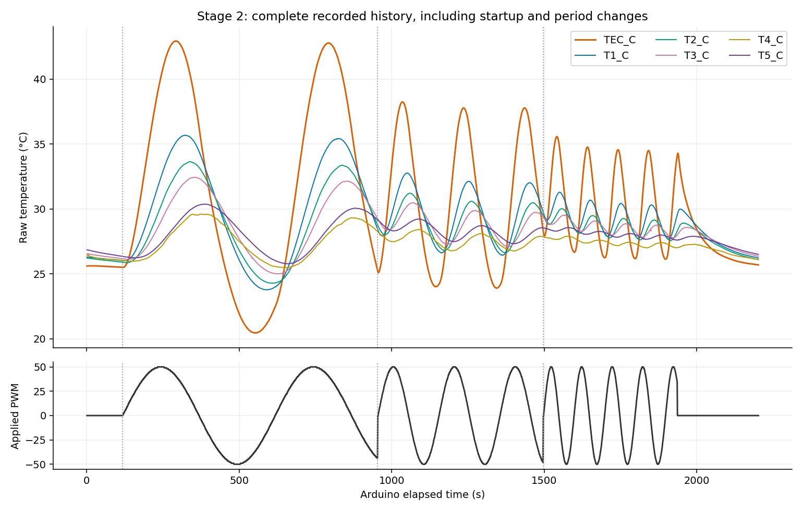
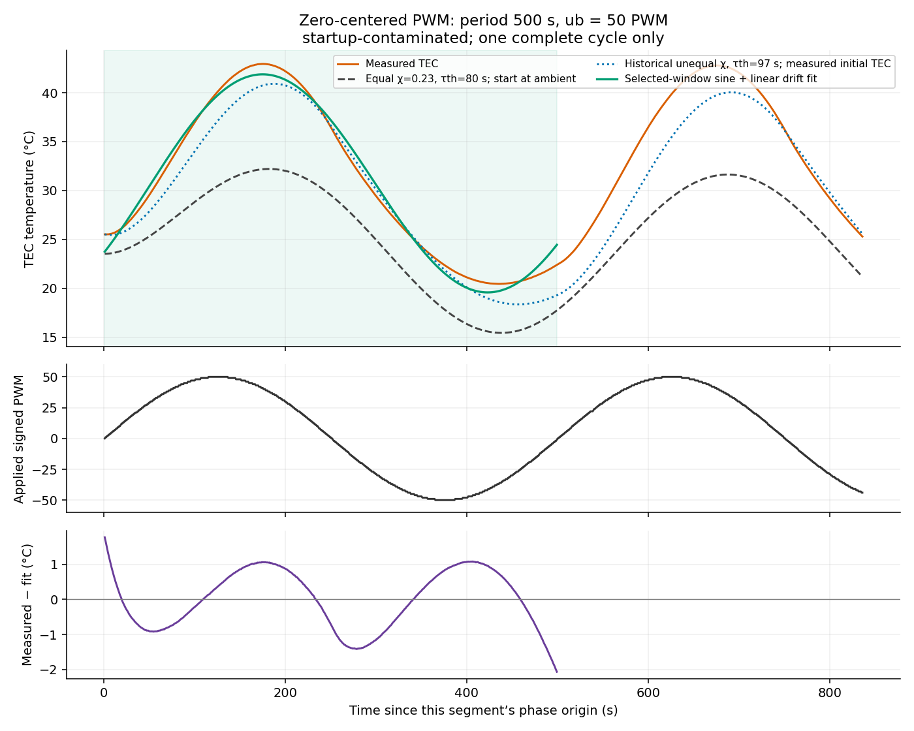
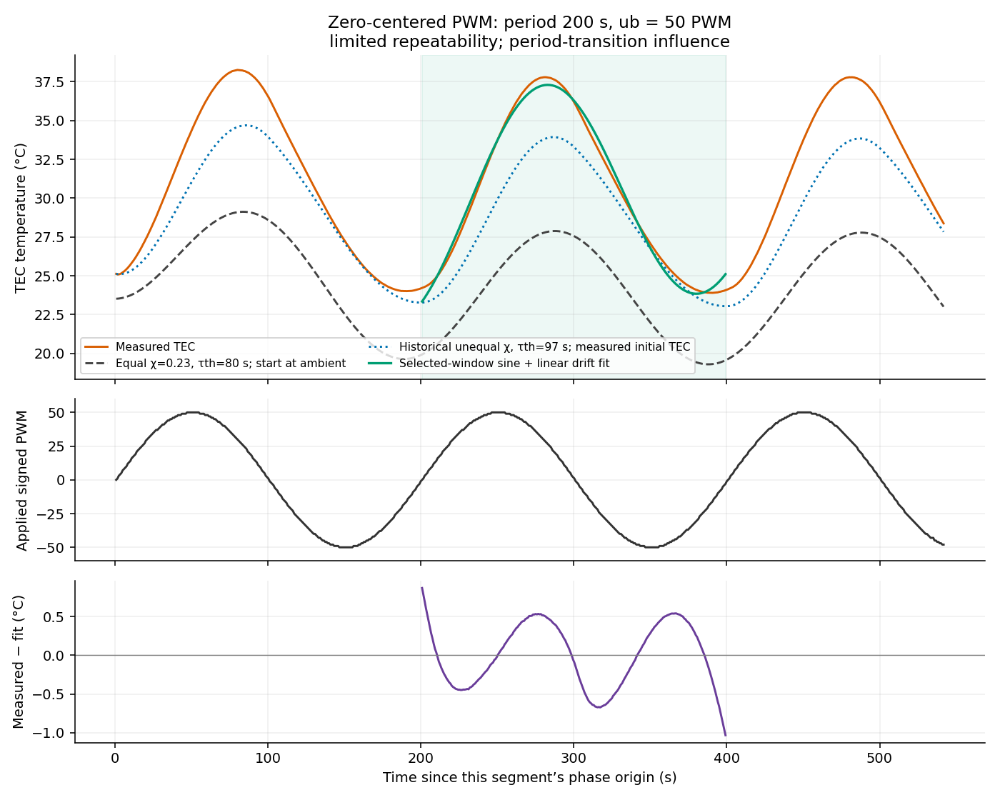
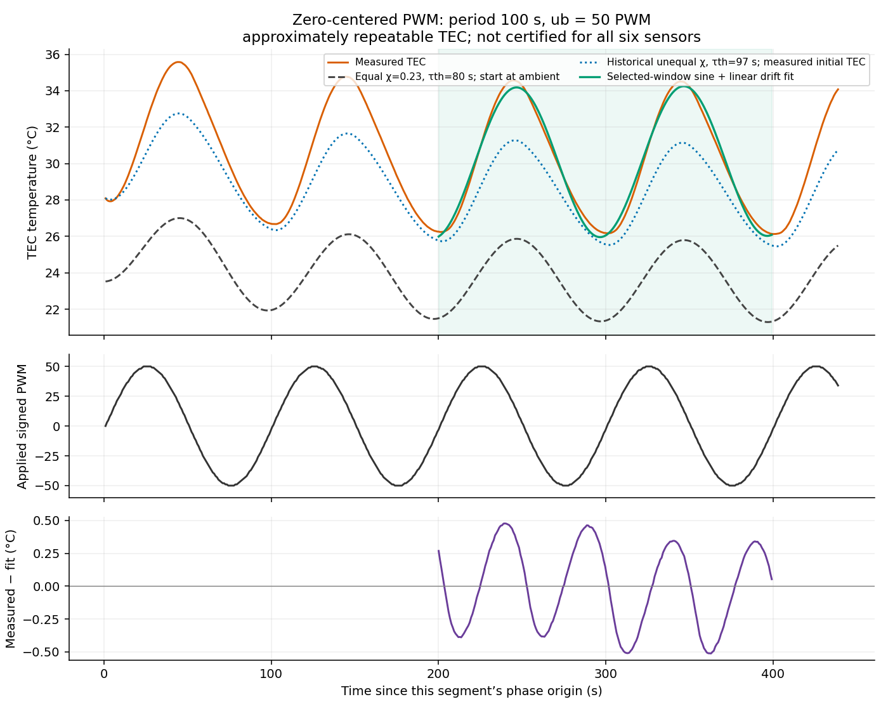
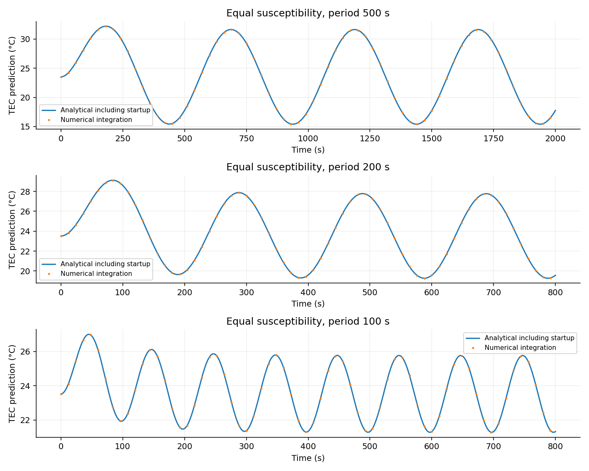
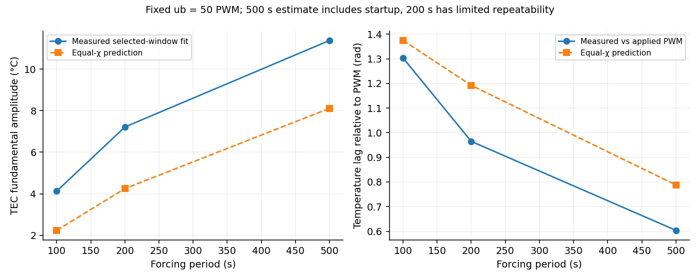

# Stage 2: Uncompensated sinusoidal PWM

## Recorded settings and source

The instructor-directed zero-centered trial used **ua = 0**, **ub = 50 PWM**, and periods **500, 200, then 100 s**. These replace the earlier suggested 100-PWM starting amplitude. The earlier ub = 100 pilot is separate and is not pooled into this comparison.

Raw record: [CSV](../../python/run_data/run_20261109_111119_352877_manual_kp1_ki0p08.csv). Keep its matching [command log](../../python/run_data/run_20261109_111119_352877_manual_kp1_ki0p08_commands.csv) and [events](../../python/run_data/run_20261109_111119_352877_manual_kp1_ki0p08_events.jsonl). Raw data remain unchanged. All analyzed running segments report safety OK.

Analysis ambient: **23.52 °C**, the user-approved six-sensor baseline estimate. The GUI event log records **22 °C** for these segments; that original metadata is retained. The apparatus was warmer at the start of this file, so 23.52 °C is an assumed reference, not a fresh independent ambient measurement. Sine-fit amplitude and phase do not depend on subtracting this constant.

## Temperature and applied PWM history



## Fitted TEC response

Fit at the known drive frequency: T = c + d(t − tmid) + a sin(ωt) + b cos(ωt). Report B = sqrt(a²+b²), phase = atan2(b,a), and lag = phase(PWM) − phase(TEC), wrapped to (−π,π]. Fit applied signed PWM at the same times. Mean c is evaluated at the selected window midpoint; d is a separate linear-drift estimate. Values are descriptive fits, not validated steady-state parameter estimates or total uncertainty bounds.

Use the last complete cycle at 500 and 200 s and the last two complete cycles at 100 s. The event log supplies the phase origin. Small edge gaps up to two median sample intervals are tolerated; gaps over 5 s reject a cycle. No startup samples are deleted from the raw record or full-history plot.

| Period (s) | Retained cycles | TEC mean (°C) | Fundamental B (°C) | Lag (rad) | Lag (s) | Drift (°C/min) | Fit RMS (°C) |
|---:|---:|---:|---:|---:|---:|---:|---:|
| 100 | 3–4 | 30.088 | 4.128 | 1.304 | 20.75 | +0.040 | 0.310 |
| 200 | 2–2 | 30.255 | 7.213 | 0.965 | 30.71 | +0.594 | 0.416 |
| 500 | 1–1 | 30.640 | 11.373 | 0.604 | 48.05 | +0.106 | 0.841 |

| Period (s) | Excursion above fitted mean (°C) | Below fitted mean (°C) | Harmonic distortion estimate (%) |
|---:|---:|---:|---:|
| 100 | 4.475 | 3.951 | 10.80 |
| 200 | 7.532 | 6.355 | 10.48 |
| 500 | 12.307 | 10.195 | 13.28 |

Excursions use the observed extrema within the fitted window and its midpoint mean; drift/startup can contribute to their inequality. The distortion estimate is sqrt(B2²+B3²)/B1 from a separate three-harmonic-plus-drift fit. With one transient cycle this is descriptive, not a clean steady harmonic measurement.

### Settling limits

**500 s:** only one complete cycle was captured before changing period. It includes startup, so settling and repeatability cannot be established. **200 s:** two complete cycles were captured, with a change in mean between them; only the later complete cycle is fitted. **100 s:** later TEC cycles are approximately repeatable, but this does not certify a settled six-sensor profile. No numerical settling criterion was declared before this acquisition; no new threshold is retroactively presented as a pass. [Cycle-by-cycle fits](analysis_output/cycle_comparison.csv) retain the evidence.

### 500 s trial



### 200 s trial



### 100 s trial



## Equal-susceptibility derivation and checks

For the required illustrative equal-branch model take χh = χc = χ = 0.23 °C/PWM, τth = 80 s, and ub = 50 PWM. The common χ is chosen explicitly from the supplied default cooling magnitude; it is not claimed to represent both measured branches. The period is distinct from τth.

For $\theta=T-T_{\rm room}$, $\tau_{\rm th}\dot\theta+\theta=\chi u_b\sin(\omega t)$. Substitute $\theta_p=a\sin(\omega t)+b\cos(\omega t)$:

```math
a-\omega\tau_{\rm th}b=\chi u_b,\qquad b+\omega\tau_{\rm th}a=0.
a=\frac{\chi u_b}{1+(\omega\tau_{\rm th})^2},\qquad b=-\frac{\chi u_b\omega\tau_{\rm th}}{1+(\omega\tau_{\rm th})^2}.
```

```math
T(t)=T_{\rm room}+\frac{\chi u_b}{\sqrt{1+(\omega\tau_{\rm th})^2}}\sin(\omega t-\delta)+Ce^{-t/\tau_{\rm th}},
\delta=\tan^{-1}(\omega\tau_{\rm th}),\quad C=\frac{\chi u_b\omega\tau_{\rm th}}{1+(\omega\tau_{\rm th})^2}\quad[T(0)=T_{\rm room}].
```

At t = 0, the sine contribution equals −C, satisfying the initial condition. For the sinusoidal terms, the sine coefficient is a − ωτth b = χub and the cosine coefficient is b + ωτth a = 0. For the homogeneous term, τth d(C exp(−t/τth))/dt + C exp(−t/τth) = 0. Thus the complete expression satisfies both the ODE and initial condition.

| Period (s) | Normalized amplitude B/(χub) | Predicted B (°C) | δ (rad) | δ/ω (s) |
|---:|---:|---:|---:|---:|
| 100 | 0.1951 | 2.244 | 1.3744 | 21.87 |
| 200 | 0.3697 | 4.252 | 1.1921 | 37.95 |
| 500 | 0.7052 | 8.110 | 0.7880 | 62.71 |



Numerical integration agrees with the analytical result to a maximum absolute error of **4.92e-12 °C**. Direct analytical substitution and the initial-condition check pass. [Numerical predictions](analysis_output/equal_susceptibility_predictions.csv).

## Comparison and interpretation



At fixed PWM amplitude, temperature amplitude increases with period. The equal-susceptibility model predicts B/(χub) = 1/sqrt[1+(ωτth)²], so constant PWM amplitude does **not** produce constant temperature amplitude across frequencies. The measured fitted amplitudes show the same ordering, subject to the limited 500/200 s settling evidence. The phase in radians generally increases at shorter periods in the one-lump prediction, while the time delay δ/ω need not increase.

The equal-χ model oscillates about room temperature after startup. The measured TEC response is biased above the ambient estimate and is not perfectly sinusoidal: unequal heating/cooling gains can create a mean shift, unequal excursions/slopes and harmonic distortion. A fixed sign-switching susceptibility is already nonlinear with respect to a single linear sinusoidal model. The linear-drift sine residual plots show the remaining mismatch; third-harmonic fit metrics are saved as a descriptive distortion check, not proof of a settled waveform.

The dotted refined predictions use historical measured χh = 0.4872434 and χc = 0.1956676 °C/PWM, τth = 97 s, actual applied PWM, and measured initial TEC temperature for each segment. They are numerical one-lump estimates, not fits. Attaching the rod can change dynamics and equilibrium gains; use model discrepancies as evidence, not as a reason to alter raw data.

## Saved evidence and remaining work

- [TEC metrics](analysis_output/tec_metrics.csv), [all-six sensor fits](analysis_output/six_sensor_metrics.csv), [residuals](analysis_output/fit_residuals.csv), [segments](analysis_output/segments.csv), and [provenance hashes](analysis_output/provenance.json).
- Reproduce this exact snapshot with `python3 python/analysis/analyze_stage2.py --snapshot docs/stage_2/analysis_output/input_snapshot_fbdf1eb4a069` from the repository root (NumPy, SciPy and Matplotlib required). The snapshot is a byte-for-byte raw copy; the live logger may append to the original without changing this analysis input.
- **S18.4 positive-only PWM has not been acquired in this recording.** It still needs ua > ub > 0, adjustment of ua toward mean TEC ≈40 °C, and comparison of mean/amplitude/phase/symmetry/distortion. No values or result are invented for it.
- A repeated complete 500 s cycle is needed if settled-repeatability evidence is required for that period. Preserve this pilot even if a further run is acquired.
